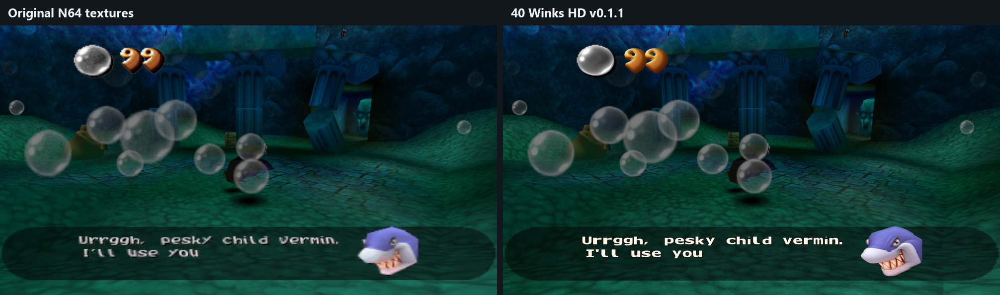

# 40 Winks HD

A Windows texture rework for the Nintendo 64 prototype of *40 Winks*. Look for sharper bedroom posters, repainted ship decks and new portraits and lettering in the original levels.

**[Download the Windows ZIP](https://github.com/IvoFehn/40-winks-hd/releases/download/v0.1.1/40-Winks-HD-v0.1.1-Windows-x64.zip)** · [Installation](#play-on-windows) · [Original vs. HD](#original-vs-hd)


## Features

- **2,476 replacement textures per pack.** Both HD and UHD are in the download. Most were redrawn with ImageGen using the game's artwork as a reference.
- **Repainted environments.** Wood planks, cave masonry, grass, stained glass, quilt patterns and bedroom posters.
- **Sharper UI.** Matching gold HUD digits, redrawn icons, revised subtitle spacing and new bitmap lettering.
- **Rebuilt portraits and effects.** Tic Tac, the pirate and the parrot have revised cutouts. The packs also cover animated fire, smoke and water textures.
- **Full HD, WQHD and 4K.** Choose 4:3 or 16:9. Native 4K renders at 3840 × 2160 in 16:9 or 2880 × 2160 in 4:3 and fits the result to your screen.
- **Scene fixes.** Dedicated renderer and camera adjustments for frame edges in Moon Caves, Dungeons and Dragon Race.

## Play on Windows

You need Windows 10 or 11 (64-bit), an OpenGL-capable graphics driver and your own **European N64 prototype dated 7 October 1999** (English, Spanish and Italian, `.z64`). The ZIP supplies the launcher and textures. You provide the ROM.

1. **Download and extract** the full Windows ZIP to a writable folder on an NTFS drive, such as a folder under Downloads.
2. **Copy your `.z64` into that folder**, right beside `40 Winks HD.exe`. Keep the `game` folder there too.
3. **Open `40 Winks HD.exe`.** Choose `1` for Full HD (1920 × 1080), `2` for WQHD (2560 × 1440), `3` for 4K UHD or `4` for native 4K rendering, even on a smaller display.
4. **Choose your framing.** Enter `1` for 4:3 or `2` for widescreen. Keep an internet connection on the first launch of each emulator mode so the launcher can set it up.
5. **Pick the game's language with the arrow keys and press Enter.** Use the arrow keys to move. Open the launcher again after closing the game to change display mode.

<details>
<summary>Keyboard controls, saves and ROM check</summary>

| Action | Modes 1–3 | Mode 4 |
| --- | --- | --- |
| Move | Arrow keys | Arrow keys |
| Start / confirm language | Enter | Enter |
| N64 A | X | D |
| N64 B | C | X |
| N64 Z | Z | Z |

Modes 1–3 share saves in `game/runtime/rmg/Save`. Mode 4 keeps its own in `game/runtime/4k-internal/saves`.

The launcher checks the file contents, so you can keep the original filename. If it reports a missing ROM, check that your `.z64` is beside the EXE and that PowerShell's `Get-FileHash -Algorithm SHA256 -LiteralPath 'your-game.z64'` returns this fingerprint.

```text
899B866A45DFBEBC8152A3122F28AA0BA906FB448DC6B2DC7C7442E7622B5442
```

</details>

## Original vs. HD

Original N64 textures on the left, the released **v0.1.1 UHD pack** on the right. Both sides are rendered at 3840 × 2160 in the same scene, with texture replacements disabled for the original.

### Shipwreck City


### Atlantis



[More comparisons and capture details](docs/screenshots.md)

## Release notes and credits

v0.1.1 revised 121 textures in each pack. Some rare effects and variants still need in-game checks. Three ambiguous texture IDs use the original graphics. [Release notes](https://github.com/IvoFehn/40-winks-hd/releases/tag/v0.1.1) · [HD manifest](docs/hd-textures.csv) · [UHD manifest](docs/uhd-textures.csv)

Unofficial fan project. The original game and characters belong to their respective rights holders. [Emulator credits and source](docs/third-party.md)
