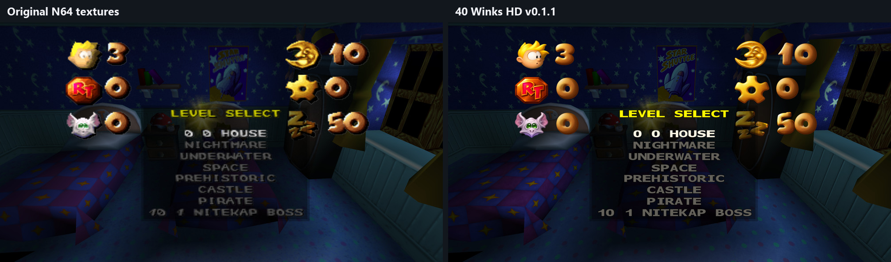

# 40 Winks HD

40 Winks on Windows and in the browser, with statically recompiled game code and HD artwork.

**[Download v0.2.0-preview](https://github.com/IvoFehn/40-winks-hd/releases/tag/v0.2.0-preview)** · [Build from source](docs/building.md) · [More screenshots](docs/screenshots.md)



## Features

- **Native Windows EXE.** The N64 CPU code is compiled ahead of time into the application.
- **Browser build.** WebAssembly game code with WebGPU rendering, local ROM import and offline startup after caching.
- **2,476 replacements in each full pack.** Switch between Original, HD and UHD in the Windows overlay. The browser downloads the pack selected before launch.
- **Live settings on Esc.** Graphics, texture quality, audio, controls and Quit Game in one menu.
- **Display options.** Full HD, WQHD and 4K, with aspect-ratio controls. Windows offers fullscreen, windowed and borderless fullscreen.
- **Keyboard, gamepad and browser touch controls.** Mobile has a lighter 18 MB pack of 1,141 replacements. Larger motifs use the ROM textures.

## Play on Windows

1. Download **40-Winks-HD-v0.2.0-preview-Windows-x64.zip** and extract the entire archive.
2. Put your own **European N64 prototype dated 7 October 1999** beside **40 Winks HD.exe**. The English/Spanish/Italian N4WX dump is supported.
3. Open **40 Winks HD.exe**. The settings overlay opens on first launch. Pick a texture pack and close the overlay to play.
4. Press **Esc** whenever you want to change settings or quit.

Keep the DLLs and `assets` folder alongside the EXE. Windows 10/11 x64 and a graphics driver supporting the renderer's Vulkan or Direct3D 12 backend are required.

| Action | Keyboard |
| --- | --- |
| Move | WASD or arrow keys |
| Confirm / N64 A | Enter or Space |
| N64 B | Left Shift or C |
| N64 Z | Q or Z |
| N64 Start | P |
| Camera / C buttons | I, J, K, L |
| Settings | Esc |

Gamepad defaults are included. Use Controls to change bindings. Windows keeps configuration and saves under `%LOCALAPPDATA%/40WinksHDPrototype`.

## Play in a browser

Extract **40-Winks-HD-v0.2.0-preview-Web.zip**. Run `python serve.py` in that folder, then open `http://127.0.0.1:8097/40WinksRecompiled.html`.

Choose **Mobile**, **HD**, **UHD** or **Original**, press **Play**, then select your own ROM through **Load ROM**. The browser finishes loading the selected assets before starting the program. ROM data stays on the device and persists in local browser storage alongside settings and saves.

The ZIP can also be hosted as static files over HTTPS. A hosted copy is needed to open it from another device. WebGPU, WebAssembly threads and cross-origin isolation are required. The bundled service worker supports static hosts that cannot set isolation headers.

## Preview status

The Windows build and browser startup use the same supported prototype. Basic rendering, HD replacement loading, keyboard controls and a cold offline browser restart have been checked. Browser touch controls were checked in a simulated mobile viewport. Real iPhone/Android compatibility, audio quality and later levels still need device and gameplay checks.

The comparison images show the original ROM artwork and the v0.1.1 texture rework captured with the earlier renderer. Those same full HD/UHD packs are included in this release.


## ROM and credits

Supply your own game dump. Its SHA-256 in `.z64` byte order is

```text
899b866a45dfbebc8152a3122f28aa0ba906fb448dc6b2dc7c7442e7622b5442
```

The source tree includes recompilation configuration, function addresses, dependency pins and patches. The CPU and RSP sources are generated locally from your ROM when building.

Based on DreaXer's 40WinksRecomp / Dreamcompiled, N64Recomp, N64ModernRuntime, RecompFrontend and RT64. Web support uses N64Recomp-browser. [Build and dependency details](docs/building.md) · [Third-party credits](docs/third-party.md)

Unofficial fan project. The original game and characters belong to their respective rights holders. Earlier emulator-based packages remain available under the v0.1.x tags.
