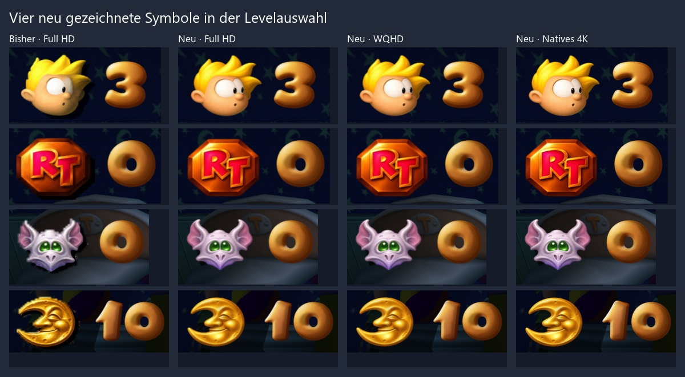
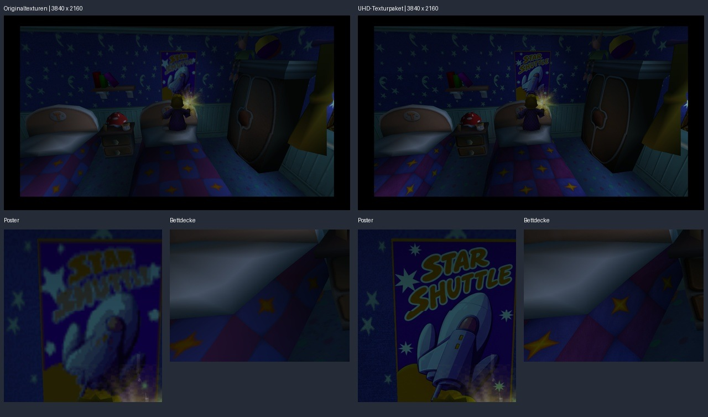
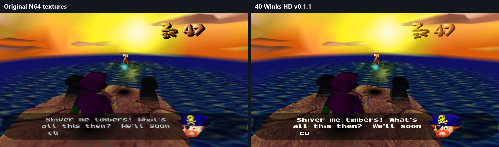
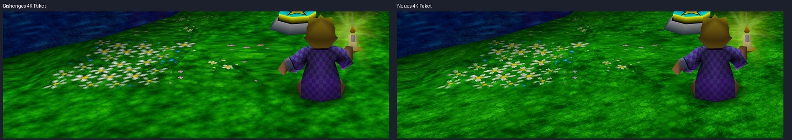
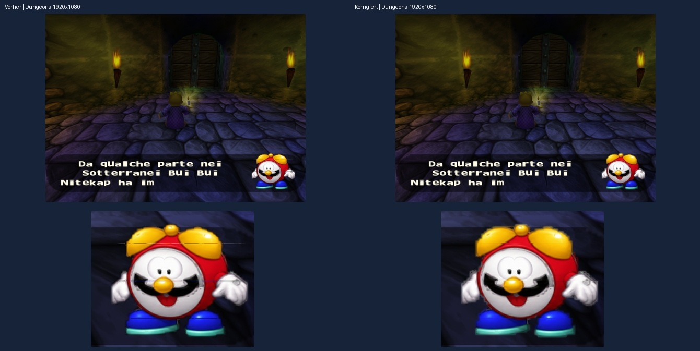

# 40 Winks HD

A fan-made texture rework of the Nintendo 64 version of *40 Winks* for Windows. It redraws the bedroom poster, ship decks, dungeon masonry, menu art, portraits and lettering while keeping the original game and levels.

[Download the Windows preview](https://github.com/IvoFehn/40-winks-hd/releases/tag/v0.1.1)

## Play on Windows

1. Download and extract **40-Winks-HD-v0.1.1-Windows-x64.zip** into a writable folder on an NTFS drive.
2. Put your own `.z64` next to **40 Winks HD.exe**. Use the European prototype dated **1999-10-07** (English, Spanish and Italian). The launcher checks the file contents, so the filename can vary.
3. Open **40 Winks HD.exe** and choose a resolution and aspect ratio. Press **Enter** on the game's language screen to confirm. The first launch of each emulator mode needs an internet connection to download the pinned upstream emulator. Later starts use the files already set up.

Windows 10 or 11 x64 with working OpenGL drivers is required. The release archive includes both texture packs. The ROM is supplied separately by the player.

<details>
<summary>ROM fingerprint and keyboard controls</summary>

Expected SHA-256

```
899B866A45DFBEBC8152A3122F28AA0BA906FB448DC6B2DC7C7442E7622B5442
```

| Action | Modes 1–3 | Mode 4 |
| --- | --- | --- |
| Move | Arrow keys | Arrow keys |
| N64 Start | Enter | Enter |
| N64 A | X | D |
| N64 B | C | X |
| N64 Z | Z | Z |

The RMG and RetroArch modes keep separate saves in `game/runtime/rmg/Save` and `game/runtime/4k-internal/saves`.

</details>

## What changed

- The HD and UHD packs each contain **2,476 replacement textures**. The pack includes AI-assisted redraws, a separately redrawn bitmap font and revised masks for effects and transparency.
- Redrawn HUD numbers and portraits use the original texture positions. Multi-part artwork such as Tic Tac's portrait was reassembled and checked at the tile boundaries.
- The launcher offers 1920 × 1080, 2560 × 1440 and 3840 × 2160 display modes with 4:3 and 16:9 framing. **Native 4K** renders internally at 3840 × 2160 in 16:9 or 2880 × 2160 in 4:3, then fits the monitor.
- Renderer adjustments address missing scenery and stale edge pixels in tested scenes, including Moon Caves, Dungeons and Dragon Race.

## v0.1.1

Each texture pack includes 121 revised files. All ten HUD digits now use a matching gold design, with cleaner edges and more room around the zero in two-digit counts. The moon, gear, RT badge and character icons were redrawn. This release also updates dialogue portraits and blink frames, two subtitle glyphs, and the joins on the Star Shuttle and The Magic Land posters.

## Before and after

### Level select

The comparison shows Ruff, the RT badge, the bat and moon icons with the earlier and revised textures. The new textures were captured at Full HD, WQHD and native 4K.



[Gold HUD digits and gear](docs/images/hud-digits.jpg) · [Bedroom poster joins](docs/images/bedroom-poster-joins.jpg) · [Dialogue glyphs j and 1](docs/images/dialogue-glyphs.jpg)

### The bedroom

Original graphics on the left, UHD pack on the right. The Star Shuttle poster and quilt are shown up close below the scene.



### Shipwreck City

The pirate's dialogue, portrait and deck change with the HD pack. The original capture is 1080p and the rework capture is 1440p.



### Castle courtyard

The earlier 4K pack is on the left. The revised grass and flowers on the right use a shared ground texture at the seams.



### Tic Tac in Dungeons

A close-up shows the lines across the earlier portrait on the left and the corrected tile joins on the right.



[Compare the Dungeons frame edges while the camera moves](docs/images/dungeons.jpg) · [See the Atlantis portrait and dialogue comparison](docs/images/atlantis.jpg)

## Status

The Windows ZIP contains the complete HD and UHD packs for v0.1.1. The scene comparisons cover the changes shown above. Some rare effects and texture variants still need a check at their in-game locations. The pack leaves three known conflicting texture keys to the emulator's original graphics because each key can refer to different artwork. [HD texture manifest](docs/hd-textures.csv) · [UHD texture manifest](docs/uhd-textures.csv)

This is an unofficial project. The original game and its characters belong to their respective rights holders. [Emulator credits and source](docs/third-party.md)
